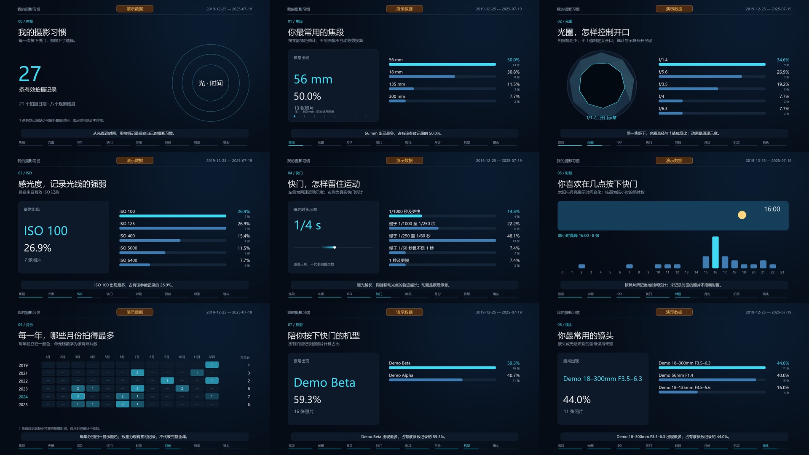

# 摄影习惯数据视频 · photo-habits-video

**从照片 EXIF 统计你的拍摄习惯，再把焦距、光圈、ISO、快门、时间与设备变成数据动画。**

这是一个可安装的 Codex Skill，附带本地扫描、保守去重、增量分析和视频渲染脚本。它把一次完整的摄影数据回顾流程整理成可重复使用的方法：先展示数据和覆盖范围，按用户约定的开始时机制作视频；后续新增硬盘可以合并数据、复用动画。

## 演示

以下画面完全来自仓库内的虚构元数据，每个画面都标有“演示数据”。



[查看或下载 35 秒演示视频（含本地合成配乐）](docs/demo.mp4)

## 可以做什么

- 统计常用焦距、光圈、ISO、快门、相机和镜头，并显示各字段的有效数据量。
- 分析一天哪些时段拍得多、每年哪些月份拍得多，区分照片数量与拍摄天数。
- 合并多个目录和导入批次；相同文件名但拍摄参数不同的照片分别保留。
- 保存疑似重复与用户决定，便于新硬盘加入后继续分析。
- 制作带中文文字的数据动效 MP4：光圈开合、日夜时刻变化、快门轨迹示意、年月热力图和设备排名。
- 按需增加官方产品图衍生设备贴图；需要相应图像编辑工具和预算，数据版不依赖它。

适合摄影年度回顾、器材使用盘点和个人照片库分析。它不是通用剪辑器，也不根据照片内容评判作品好坏。

## 安装 Skill

### 推荐：让 Codex 安装

在已有 Skill Installer 的 Codex 中复制这句话：

```text
$skill-installer 请从 https://github.com/leisurer6/photo-habits-video-skill 安装 skills/photo-habits-video。
```

安装器会选择当前环境的技能目录。安装后用 `$photo-habits-video` 调用；若列表尚未更新，重启 Codex。

### 或者：手动安装

下载本仓库，把整个 `skills/photo-habits-video` 文件夹复制到个人技能目录 `~/.agents/skills/`，保留内部结构。只在某个项目使用时，也可以放到该项目的 `.agents/skills/` 下。

```text
~/.agents/skills/photo-habits-video/SKILL.md
```

以上手动目录与发现机制依据 [OpenAI 官方技能文档](https://learn.chatgpt.com/docs/build-skills)。不同版本自带安装器可能使用已有的 `~/.codex/skills` 目录；使用安装器时遵从它的实际结果，不要把同名技能同时安装到多个目录。

Skill 是工作说明和脚本，不会自动安装系统工具。真实照片扫描需要 ExifTool，视频渲染需要下文的 Python 依赖与 FFmpeg。可以让 Codex 检查已有环境后仅补齐缺少的部分。

## 三种直接可用的对话

**先看数据，暂不制作：**

```text
用 $photo-habits-video 分析 C:/Photos/2024 和 C:/Photos/2025。
先统计并展示去重结果、常用焦距/光圈/ISO/快门、拍摄时段、每年月度分布和设备。
先不要制作视频，等我说“开始”。疑似重复先保留并标记。
```

**看过数据后开始制作：**

```text
开始！用刚才展示的数据做约 60 秒、16:9 的摄影习惯动画。
深色底、白字、青蓝色图表，中文字幕，轻节奏音乐，无旁白，不展示我的照片。
加入光圈开合、太阳月亮表示时间、快门轨迹和年月热力图。
先用数据图表完成；设备贴图只有工具可用且不增加超出约定的成本时再加。
```

**新增一块硬盘，继续增量：**

```text
用 $photo-habits-video 把 C:/NewPhotos 加入上次数据。
这是另一块硬盘，给它独立的导入批次；同名但拍摄时间或参数不同的照片要保留。
继承我上次的疑似重复决定，先给我新旧数量对比和新增后的统计，再更新视频。
```

路径、长度、语言、风格和声音都可以修改。已经明确授权制作时，技能不会要求再次说“开始”。

## 不用照片也能试跑

仓库的演示元数据完全虚构。下面的流程不扫描你的照片，不需要 ExifTool，不调用图像生成或其他外部 API；安装依赖可能需要网络，运行本身是本地计算。通过 Codex 对话使用技能仍遵从你现有的产品额度。

在仓库根目录运行（以下单行命令兼容 PowerShell）：

```powershell
git clone https://github.com/leisurer6/photo-habits-video-skill.git
cd photo-habits-video-skill
python -m pip install -r requirements.txt
python skills/photo-habits-video/scripts/photo_stats.py demo --output runs/demo
python skills/photo-habits-video/scripts/render_video.py --summary runs/demo/summary.json --output runs/demo/demo.mp4 --duration 35 --size 960x540 --silent --preview
python skills/photo-habits-video/scripts/render_video.py --summary runs/demo/summary.json --output runs/demo/demo.mp4 --duration 35 --size 960x540 --silent
```

先打开 `runs/demo/report.md` 看统计，查看预览后再播放 `runs/demo/demo.mp4`。静音参数用来快速验证画面；自己的成片可以添加有权使用的 WAV 音乐。

## 高级：直接使用命令行

### 准备工具

使用 Python 3.10 或以上版本，安装 `requirements.txt` 中的 NumPy、Pillow 和 imageio-ffmpeg。扫描与分析脚本使用标准库；只有读取真实照片时需要 [ExifTool](https://exiftool.org/)。渲染器可查找本机 FFmpeg 或 imageio-ffmpeg 的二进制，也可用 `--ffmpeg` 指定支持 H.264 的版本。手动下载参见 [FFmpeg 官方下载页](https://ffmpeg.org/download.html)。

中文字体需要覆盖中文字形。Windows 通常可以使用微软雅黑，其他平台可安装有权使用的中文字体并通过 `--font` 指定字体文件；仓库不捆绑商业字体。

### 扫描与首次分析

请将 `C:/Photos` 和工具路径替换为自己的实际路径。原照片只读，所有产物写入 `runs/`：

```powershell
python skills/photo-habits-video/scripts/photo_stats.py scan --root "C:/Photos" --batch-id disk-a-001 --output runs/scan-a --exiftool "C:/Tools/exiftool.exe" --hash-mode full
python skills/photo-habits-video/scripts/photo_stats.py analyze --input runs/scan-a/metadata.json --output runs/v1
```

同一来源批次有多个目录时可以重复 `--root`；分析多个扫描结果可以重复 `--input`。使用 ExifTool 的 Perl 版时再传 `--perl`，路径指向本机 Perl 可执行文件。

哈希模式：`full` 对所有文件计算完整内容哈希，适合跨批次核对副本；`candidates` 只计算本次扫描内同大小候选文件的完整哈希，读盘较少，但不代表对整个库或历史批次完成了内容核验；`none` 跳过哈希。默认候选模式的证据不足时，分析会保守保留疑似项。

### 新硬盘增量

新物理盘使用新的 `batch-id` 和扫描输出目录，即使它与旧盘使用了同一盘符或目录名。`--baseline` 指向前一次**分析结果目录**：

```powershell
python skills/photo-habits-video/scripts/photo_stats.py scan --root "C:/NewPhotos" --batch-id disk-b-001 --output runs/scan-b --exiftool "C:/Tools/exiftool.exe" --hash-mode full
python skills/photo-habits-video/scripts/photo_stats.py analyze --input runs/scan-b/metadata.json --baseline runs/v1 --output runs/v2
```

分析会继承旧的来源记录、拍摄记录身份及保留决定。疑似重复默认保留，不会删除任何照片。确认时钟重置等异常日期后，可用 `analyze --exclude-date YYYY-MM-DD` 将该日期排除出时间统计；照片的其他有效参数仍参与对应统计。

### 渲染自己的视频

```powershell
python skills/photo-habits-video/scripts/render_video.py --summary runs/v2/summary.json --output runs/v2/video.mp4 --duration 60 --preview
python skills/photo-habits-video/scripts/render_video.py --summary runs/v2/summary.json --output runs/v2/video.mp4 --duration 60 --music "C:/Audio/music.wav"
```

未指定音频参数时，渲染器默认在本地合成轻节奏背景音乐，不调用音频服务。`--music` 替换为自己的 WAV，`--silent` 输出无音轨版。使用 `--size 960x540` 可做低分辨率试片，用 `--font`、`--ffmpeg` 指定现有工具；精确参数与默认值以各脚本 `--help` 为准。

可选 `--assets local-assets/assets.json` 接受设备素材映射。键名应与统计内原始机型、镜头标签一致，相对图片路径以这个 JSON 所在目录为基准：

```json
{
  "camera": {"EXIF_MODEL": "sprites/body.png"},
  "lens": {"EXIF_LENS": "sprites/lens.png"}
}
```

贴图不随仓库附送。渲染器只读取已经准备好的本地图片，不会自动下载官方图片或调用图像生成工具。

完整视频可以执行全片解码和音轨检查，检查结果写到视频旁的验证文件；检查通过后仍需看画面，确认字号、遮挡和数据表达：

```powershell
python skills/photo-habits-video/scripts/verify_video.py --video runs/v2/video.mp4 --expected-duration 60 --expected-fps 30 --expected-size 1920x1080 --require-audio
```

## 文件结构和产物

```text
photo-habits-video-skill/
├── README.md
├── requirements.txt
├── docs/（虚构数据演示）
└── skills/photo-habits-video/
    ├── SKILL.md
    ├── agents/openai.yaml
    ├── scripts/
    │   ├── photo_stats.py
    │   ├── render_video.py
    │   ├── make_music.py
    │   ├── verify_video.py
    │   └── test_photo_stats.py
    ├── references/
    │   ├── metadata-and-dedup.md
    │   └── video-design.md
    └── assets/demo_metadata.json
```

每次分析保存 `metadata_all.json`（全部来源）、`records.json`（候选拍摄记录）、`summary.json`（统计）、`duplicate_candidates.json`（疑似重复）、`duplicate_decisions.json`（决定）和 `report.md`。这些文件可保留在本地，供增量分析与动画重渲染使用。

## 统计范围与隐私

统计反映当前拿得到的素材。缺失的原图、已删除的照片或尚未下载的网盘文件不会自动补齐；某月零条记录不等于没有拍照。网盘目录或缩略图通常不足以读取完整 EXIF，需要正常授权访问的原图或本地同步目录。技能不会绕过登录，也不是某个特定网盘的下载器。

RAW/JPG 配对基于完整拍摄时间、子秒、机型与曝光参数等证据；元数据缺失或连拍仍可能使同一拍摄难以判定，所以产物称为“候选拍摄记录”。疑似改名、缩图或转存副本默认保留，不以文件名直接去重。焦距、ISO、机型等排名分别使用对应有效值作分母；小时与月份默认采用相机记载的本地时间，不能从上传时间推断。

年内归一化的热力图用于观察当年旺季，跨年比较看实际数字。光圈和快门动画是参数示意，太阳月亮表示时刻，并非对实际照片模糊或真实日出日落的复原。

`runs/` 等本地运行目录已加入 `.gitignore`。请把自己的照片、EXIF、设备序列号、位置、完整路径、云盘链接与提取码、Cookie 和密钥留在本地。此公开仓库只包含技能、代码和合成示例；不包含创作来源中的个人照片、真实统计、个人成片、官方产品图或生成贴图。公开分享自己的报告或成片前，应检查其中是否包含你不希望公开的信息。
